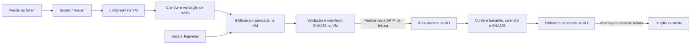

# Biblioteca do laboratório no Jellyfin existente

Implementado e validado em 31/10/2026. O usuário escolheu manter o Jellyfin do
Fedora, com biblioteca somente de leitura, em vez de criar outro servidor na VM.

## Como o fluxo funciona



Depois de solicitar um título no Seerr, acompanhe o torrent e a triagem como
antes. Quando a importação terminar, o arquivo pode aparecer em **Lab - Filmes**
ou **Lab - Séries** no Jellyfin. Os dois timers consultam a cada dois minutos;
a análise e a atualização do catálogo podem levar mais tempo.

O exportador não espera o lote inteiro de `media-triage.service` terminar:
confere cada vídeo pelos hashes já aprovados e pela estabilidade da leitura.
Triagem e exportação compartilham uma trava para solicitações ao ClamAV, com
prazo do cliente superior aos vinte minutos permitidos pelo motor. Isso evita
abandonar análises ainda ativas e deixar a fila seguinte esperando por elas.

**Não é necessário mover os arquivos manualmente.** A coleta acontece em lotes
com checkpoints por arquivo. Uma biblioteca inicial grande pode demorar; os
próximos lotes continuam automaticamente.

O endereço e as contas do Jellyfin são preservados. No próprio Fedora, abrir
<http://127.0.0.1:8096>. O Seerr continua em <http://192.168.250.10:5055>.
Não foi criada nova publicação para a internet ou configuração de reprodução
em outra máquina. O acesso LAN existente continua sujeito às regras do Fedora.

## Onde os dados ficam

| Local | Conteúdo |
| --- | --- |
| VM: `/srv/downloads/recebidos` | Originais, nunca montados no Jellyfin |
| VM: `/srv/downloads/biblioteca` | Vídeos já importados e legendas do Bazarr |
| VM: `/srv/downloads/biblioteca/.publicacao/manifest.json` | Relação dos arquivos examinados e seus hashes |
| Fedora: `lab/jellyfin/biblioteca/.em-recebimento` | Temporários privados antes da conferência, fora das pastas indexadas e sem leitura pelo usuário do Jellyfin |
| Fedora: `lab/jellyfin/biblioteca/{filmes,series}` | Cópias liberadas, montadas como `/lab-media` no Jellyfin |
| Fedora: `lab/jellyfin/state/quarentena` | Cópias gerenciadas retiradas de circulação |
| Fedora: `lab/jellyfin/runtime/config` | Estado do Jellyfin, com contas e catálogo preservados |
| Fedora: `lab/jellyfin/runtime/cache` | Cache e transcodificação do Jellyfin |

O início e encerramento estão em [USO-DIARIO.md](USO-DIARIO.md). Nesta instalação,
o volume da VM foi ampliado online para **450 GiB**, preservando os downloads.

Todos esses arquivos estão no HD. A separação é feita por diretórios,
permissões e montagens; não foi criada outra partição ou outra VM. As cópias
podem consumir espaço adicional. Não foi instalado monitoramento de espaço
nem uma rotina de backup.

## Controles e limites

- A VM continua sem acesso geral ao Fedora/LAN. O host inicia a coleta; não há
  compartilhamento gravável do Fedora para qBittorrent, Sonarr, Radarr ou Bazarr.
- A conta nova `jellyfin-coleta` só usa SFTP de leitura, com chroot na biblioteca
  da VM. Não tem shell, senha de login, encaminhamento ou acesso aos originais.
- O exportador na VM usa `triagem`, sem sudo e sem rede. Vídeos precisam
  corresponder aos hashes aprovados pela primeira triagem. O vídeo não repete a análise já concluída: sua leitura sem seguir links deve
  produzir exatamente o SHA256 de um vídeo aprovado, com tamanho e inode
  estáveis durante a leitura. Legendas novas são examinadas e validadas na VM.
- A cada arquivo conferido, o exportador salva o cache de forma atômica. Após
  uma interrupção, ele reaproveita entradas com assinatura e atributos ainda
  válidos, sem publicar um manifesto parcial. Um arquivo interrompido durante a
  própria leitura precisa ser conferido novamente. O tempo máximo de uma rodada
  é de seis horas; a alteração da unidade não reinicia uma rodada em andamento.
- O Fedora recebe somente extensões admitidas, com limite de tamanho, nomes
  controlados e SHA256 exato. Ele não executa FFmpeg, scripts ou arquivos de
  mídia durante a coleta. Publicação só ocorre após a conferência completa.
- O sincronizador usa usuário dinâmico, sem sudo/grupo Docker, filesystem
  restrito, acesso de rede limitado à VM e localhost, e credenciais transitórias
  do systemd. Pastas pessoais e os demais arquivos de `/mnt` ficam ocultos.
- O Jellyfin roda como usuário sem privilégios, sem capabilities, sem ganho de
  privilégios e com raiz somente de leitura. Pode gravar apenas configuração,
  cache e temporários. Tanto a biblioteca antiga como a nova são montadas para
  leitura. Nenhum socket Docker, chave SSH ou pasta de downloads é montado nele.
- Se um arquivo gerenciado deixa de constar do manifesto ou falha na conferência,
  sua cópia publicada vai para quarentena privada, sem exclusão definitiva.
  Uma VM desligada não apaga a biblioteca já recebida.
- O limite de **2560 MiB por arquivo** da triagem continua valendo. Distribuições
  compactadas e arquivos maiores não entram automaticamente no Jellyfin.

**Antivírus e leitura apenas não garantem ausência de malware.** O Jellyfin e
seu decodificador processam mídia no kernel do Fedora por meio de containers.
Uma vulnerabilidade nesses componentes ou no kernel ainda pode comprometer o
isolamento. A alternativa mais forte é executar a reprodução em outra VM;
esta sessão escolheu usar o servidor atual.

## Atualização do servidor existente

A inspeção encontrou Jellyfin 10.11.11, afetado por avisos corrigidos em 12.0,
inclusive [travessia de caminhos na administração de bibliotecas](https://github.com/jellyfin/jellyfin/security/advisories/GHSA-6828-c7cx-hvqm)
e [referências externas em SVG](https://github.com/jellyfin/jellyfin/security/advisories/GHSA-cf3c-8m59-2vhx).
A versão instalada é a [12.4 oficial](https://github.com/jellyfin/jellyfin/releases/tag/v12.4),
fixada por digest em `jellyfin/images.lock.json`.

A aplicação recusa interromper uma reprodução ativa/pausada. Para copiar o
estado de forma consistente, para o Jellyfin, copia `/config` para dentro de
`lab` e recria apenas esse serviço com o override. A configuração original em
`/mnt/dados/Medias/jellyfin/config` é preservada para retorno; ela não recebe
as migrações de banco da nova versão. O outro serviço do projeto `medias` não
é recriado. Isso não constitui uma rotina de backup.

**Administrar o Jellyfin sempre com o override do lab:**

```bash
cd /mnt/dados/lab
bash scripts/jellyfin-compose.sh ps jellyfin
bash scripts/jellyfin-compose.sh logs --tail=80 jellyfin
bash scripts/jellyfin-compose.sh up -d --no-deps --pull never jellyfin
```

Não usar o Compose antigo sozinho para recriar esse serviço: ele não contém as
novas montagens e poderia retomar a configuração antiga. O Docker preserva as
montagens do container existente ao reiniciar o daemon/Fedora.

## Reproduzir a integração

Somente depois de concluir a base de [REPRODUZIR.md](REPRODUZIR.md):

1. Identificar o Jellyfin existente, seu projeto Compose, versão, bibliotecas,
   sessões e caminhos. Os scripts desta instalação usam o projeto `medias`,
   `/mnt/dados/Medias/compose.yml` e `medias-jellyfin-1`. Adaptar e revisar se os
   nomes/caminhos diferirem. Sem servidor existente, escolher outra implantação.
2. Rever versões e avisos oficiais antes de usar o digest fixado em data futura.
3. Executar `python3 jellyfin/prepare-host.py`. Isso só escreve em `lab`; gera
   chave SFTP dedicada, diretórios, `.env`, credencial local da API e a unidade
   systemd a partir do modelo `.service.in`.
4. Transferir `export-manifest.py`, `setup-export.py`, a chave **pública** e as
   unidades `jellyfin-export.*` para `/opt/jellyfin-export` na VM. Copiar a chave
   pública com o nome `pull-key.pub`; manter os códigos/configurações legíveis,
   sem transferir a chave privada ou a credencial da API para a VM.
5. Na VM, executar `sudo python3 /opt/jellyfin-export/setup-export.py`. Conferir
   a conta, o chroot, o timer e a emissão de manifesto.
6. Fazer os testes de integridade e SFTP antes de publicar arquivos. Obter
   autorização para atualizar/recriar o Jellyfin e instalar as duas unidades
   externas descritas abaixo, caso isso ainda não esteja autorizado na sessão.
7. No Fedora, executar `python3 jellyfin/apply-jellyfin.py`. Ele puxa o digest,
   copia a configuração consistente, atualiza o servidor e cadastra as duas
   bibliotecas, preservando identidade/usuários. Conferir que a atualização
   realmente preservou esses dados; não presumir sucesso de uma nova migração.
8. Após autorização, executar
   `sudo bash scripts/install-jellyfin-sync-host.sh`. Ele instala somente
   `/etc/systemd/system/lab-jellyfin-sync.service` e
   `/etc/systemd/system/lab-jellyfin-sync.timer`, ajusta as permissões apenas dos
   diretórios de coleta dentro de `lab` e ativa a sincronização.
9. Validar vídeo sintético, rejeição de arquivo alterado, permissões de leitura,
   acesso pelo Jellyfin e catálogo Seerr. Registrar versões e resultados em
   `state/`, sem expor credenciais. Não baixar mídia de terceiros para testes.
10. Para repetir a preferência escolhida nesta instalação, abrir as configurações
    pessoais do usuário no Jellyfin, **Legendas**, selecionar **Inglês** e o modo
    **Sempre reproduzir**. Desativar a memorização de escolhas de legenda para
    que uma escolha anterior de desligá-las não sobreponha esse padrão. Conferir
    no reprodutor; essa preferência é individual, não cria legendas ausentes.

O instalador das unidades recusa sobrescrever unidades preexistentes, salvo
com `--update-reviewed-units` depois de revisar a atualização das mesmas duas
unidades. Não usar essa opção para sobrepor unidades de outra instalação. Em uma
retomada, inspecionar o estado antes de continuar; não repetir a migração da
configuração ou gerar outra chave para contornar um erro.

## Diagnóstico e parada

```bash
systemctl status lab-jellyfin-sync.timer lab-jellyfin-sync.service --no-pager
journalctl -u lab-jellyfin-sync.service -n 50 --no-pager
cat /mnt/dados/lab/jellyfin/state/last-run.json
ssh -F /mnt/dados/lab/config/ssh_config lab-downloads-admin \
  'systemctl status jellyfin-export.timer --no-pager'
```

Para rodar uma coleta fora do horário: `sudo systemctl start lab-jellyfin-sync.service`.
Para suspender a coleta: `sudo systemctl stop lab-jellyfin-sync.timer`. Isso não
interrompe o Jellyfin nem apaga sua biblioteca.

Uma VM desligada gera erro de conexão na próxima coleta; ela tenta novamente
quando a VM voltar. Os vídeos já recebidos podem ser assistidos com a VM parada.

## Retorno à instalação anterior

Antes de retornar, parar o timer de coleta e encerrar reproduções. Recriar apenas
`jellyfin` pelo Compose original, com sua configuração original preservada fora
de `lab`. Não montar o banco já migrado da versão 12 em um servidor antigo.
O estado criado após a migração fica na configuração de `lab` e não aparece na
cópia antiga. Fazer esse retorno como manutenção explícita, com autorização,
e preservar os diretórios até confirmar o resultado.

## Limites do antivírus

Correção em 01/11/2026: o teto de 2560 MiB descrito abaixo é configurado;
o ClamAV 1.4.6 possui um limite interno próximo de 2 GiB que ele não amplia.
O Poderoso Chefão III (cerca de 2,47 GB) foi retido por
`Heuristics.Limits.Exceeded.MaxFileSize`, sem conclusão da análise. Aumentar
os números da configuração não permite aprovar esse arquivo integralmente.

O tamanho por arquivo continua limitado a 2560 MiB. O orçamento agregado de
análise (`MaxScanSize`) é 5120 MiB, pois o ClamAV conta também conteúdos internos
de containers. O orçamento inicial de 2047 MiB fazia um MP4 de cerca de 2 GB
ficar em revisão sem uma detecção de malware. A opção `AlertExceedsMax` continua
ativada; atingir qualquer limite ainda impede uma aprovação silenciosa.

## Verificações concluídas

- Jellyfin 12.4.0 com identidade do servidor e vínculo do usuário preservados;
  bibliotecas antigas mantidas e novas bibliotecas habilitadas no Seerr.
- Vídeo H.264/AAC sintético passou por qBittorrent/triagem, manifesto, SFTP,
  conferência SHA256 e catálogo. O Jellyfin entregou os bytes corretos por HTTP
  com resposta parcial 206; nenhuma mídia externa foi baixada para o teste.
- Legenda de teste legítima recebida; legenda com EICAR recusada dentro da VM.
- Escrita no volume de mídia negada pelo kernel como filesystem de leitura.
  Container confirmado sem root, sem capabilities e com raiz de leitura.
- Testes de divergência SHA256, travessia de caminho, extensão executável,
  destino com symlink e retirada para quarentena passaram.
- As fixtures foram removidas sem apagar os downloads reais. A sincronização
  inicial dos arquivos reais continua em lotes; isso não é uma etapa manual.

Os relatórios privados estão em `state/jellyfin-flow-test.json`,
`state/jellyfin-byte-gate-test.log`, `jellyfin/runtime/applied.json` e
`state/downloads-expansion.log`. A interface deve ser recarregada com
**Ctrl+Shift+R** após a atualização: autenticação antiga de clientes sem
atualização foi desativada na série 12. O coletor usa o cabeçalho moderno
`Authorization: MediaBrowser ...`.

A publicação atômica usa uma área temporária privada na mesma montagem da
biblioteca, fora de `filmes`/`series`. Isso evita renomeação entre mounts e
impede o Jellyfin de ler arquivos ainda incompletos. Não separar essas pastas
em bind mounts diferentes sem adaptar a publicação.

## Publicação

Biblioteca, temporários, quarentena, estado do Jellyfin, `.env`, unidade renderizada
para o usuário local e credenciais são privados e ignorados pelo Git. Publicar
somente código, modelos e documentação. Executar
`python3 scripts/check-publication.py` antes de preparar o envio.


Legendas anexas em CP1252/Latin-1 ou UTF-16 com BOM podem ser convertidas para
UTF-8 **na cópia privada de análise**, quando a estrutura SRT/ASS/VTT é
reconhecida e não há controles binários. A cópia convertida é examinada de novo
pelo ClamAV e recebe seu próprio SHA256. O original do torrent não é alterado;
formatos inválidos continuam retidos. Há trava por hash para impedir duas
triagens simultâneas do mesmo torrent.
